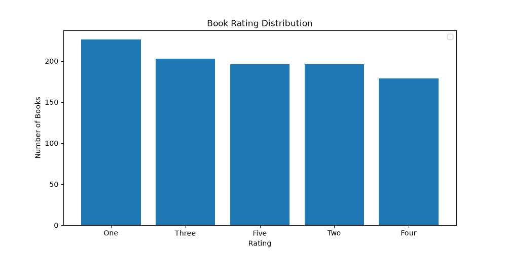
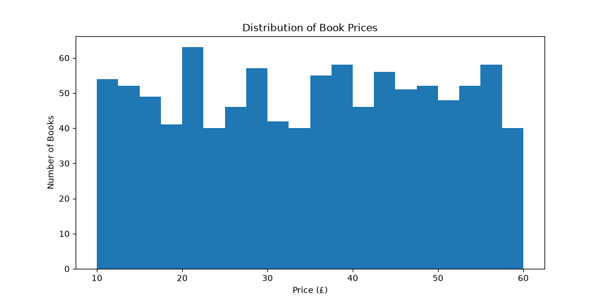
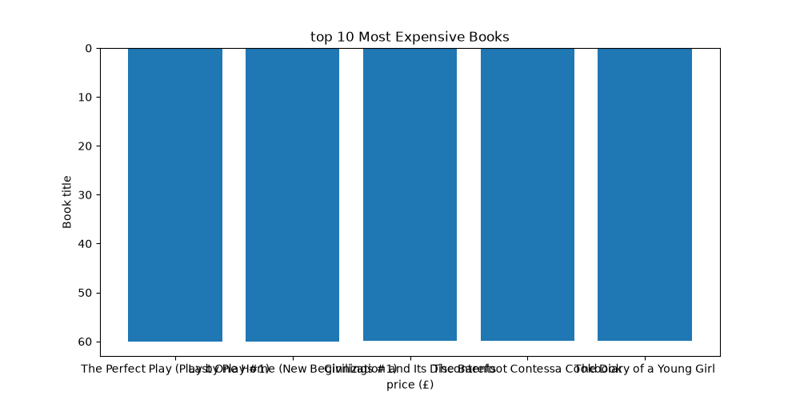
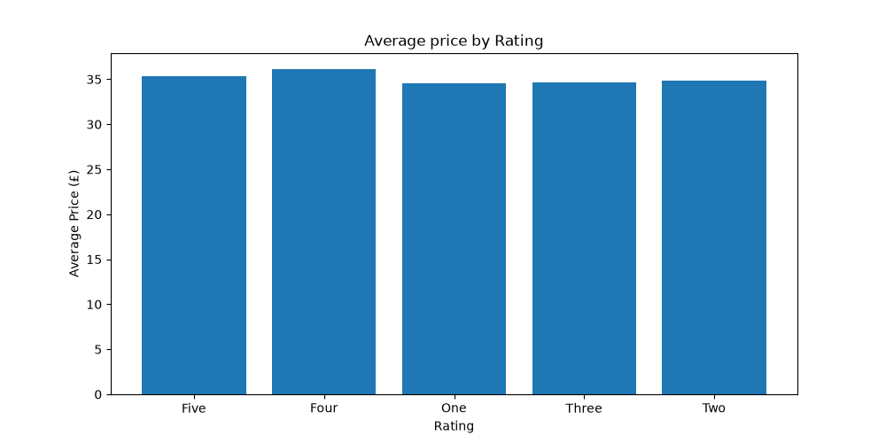

# CodeAlpha Book Data Analysis

## Project Overview

This project performs web scraping, exploratory data analysis,
and data visualization on book data collected from the
Books to Scrape website.

## Tasks Completed

- Web Scraping
- Exploratory Data Analysis (EDA)
- Data Visualization

## Technologies Used

- Python
- Requests
- BeautifulSoup
- Pandas
- Matplotlib
- Seaborn

## Dataset

The dataset contains information about 1000 books, including:

- Book Title
- Price
- Rating

## Project Workflow

Website
↓
Web Scraping
↓
Data Collection
↓
Data Cleaning
↓
Exploratory Data Analysis
↓
Data Visualization
↓
Insights

## Analysis Performed

- Dataset structure analysis
- Missing-value analysis
- Duplicate-value analysis
- Price analysis
- Rating analysis
- Cheapest and most expensive books
- Average price
- Rating distribution
- Price distribution

## Visualizations

### Rating Distribution

### Price Distribution

### Top 10 Most Expensive Books

### Average Price by Rating

## Conclusion

The project demonstrates how Python can be used to collect,
clean, analyze, and visualize real-world web data to generate
meaningful insights.